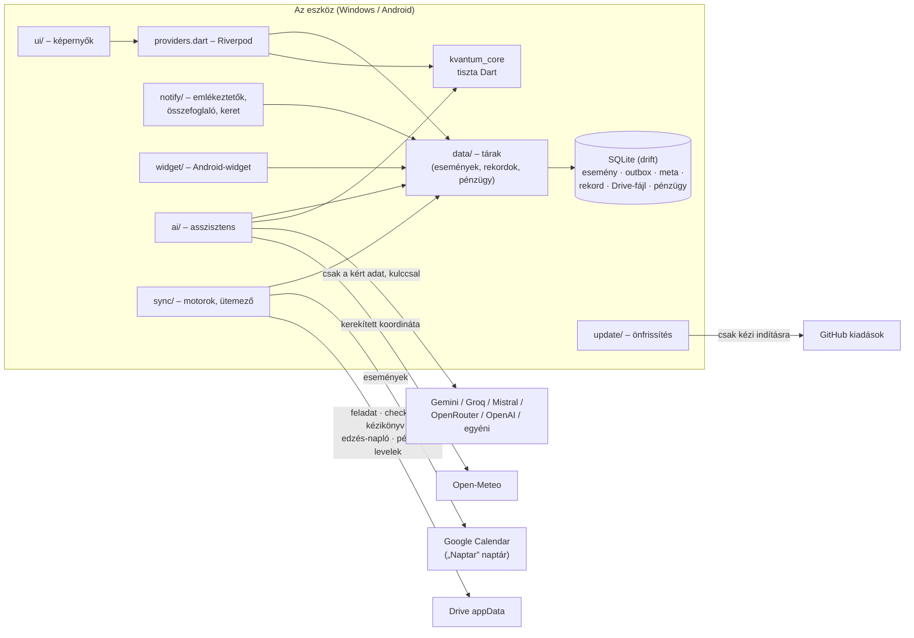

# Architektúra

Hogyan áll össze a Kvantum Naptár, és hol keresd, ha egy dolgot meg kell találni. A *miért*-ek (miért így, mi volt az alternatíva) a [döntési naplóban](DONTESI-NAPLO.md) vannak; a hibák és javítások története az [audit végrehajtási naplójában](audit-es-fejlesztesi-terv.md) és a [CHANGELOG-ban](../CHANGELOG.md).

## Az elvek röviden

- **Az adat a tiéd, az eszközön él.** Nincs saját szerver, nincs telemetria. A Google-fiókod (Calendar és a Drive rejtett `appData` mappája) a szinkron közege; a pénzügyi adat csak az eszközökön van, rövid életű „levelekkel” utazik köztük.
- **Az AI csak javasol.** Minden írás külön gombnyomásra történik; a szabályokat (alvás, puffer, energia, műszak, időjárás, határidő) **kód** ellenőrzi, nem a modell.
- **Hiba után a rendszer maga helyreáll, vagy érthetően megáll, és semmit nem veszít csendben.**
- **Egy rétegnyi saját, tiszta Dart-mag** (idő, ismétlődés, szabályok, értelmezők) – tesztelhető Flutter nélkül; az app csak összeköt és megjelenít.

## Csomagok és méretek

A számok a generált kód (a drift `db.g.dart`-ja: 4 118 sor) nélkül, az üres sorokat is számolva értendők.

| Hely | Fájl | Sor | Mi van benne |
|---|---:|---:|---|
| `packages/kvantum_core/lib/src` | 46 | ≈ 10 900 | tiszta Dart: idő és zónák (`time`), ismétlődés (`recurrence`, `rrule_convert`), `.ics` (`ics`), egyeztetés (`reconcile`), az AI szabályai és adatblokkjai (`rules`, `assistant_context`, `assistant_models`, `free_slots`, `local_answers`), a gyors felvitel értelmezője (`quick_entry`), pénzügy (`finance*`, `bank_import`, `csv_parse`, `subscriptions`), bérbecslés, keret-értesítés, magyar ünnepek (`hu_calendar`), keresés |
| `apps/kvantum_app/lib/ui` | 49 (ebből 7 a `finance/`-ban) | ≈ 13 700 | képernyők, szerkesztők, nézetek (hónap, hét, nap, napirend), navigáció (`root_shell`), visszavonás (`undo_service`) |
| `…/lib/ai` | 34 | ≈ 8 200 | asszisztens (`assistant_service` + `service/`), szolgáltatók (`gemini_`, `openai_provider`), Kézikönyv, időjárás, Beállítások (`settings_page` + `settings/`) |
| `…/lib/data` | 10 | ≈ 2 800 | drift-adatbázis, az eseményekhez / rekordokhoz / pénzügyhöz tartozó tárak (`*_repository`), takarítás, indulás |
| `…/lib/sync` | 11 | ≈ 2 300 | a naptár-szinkron motorja, ütemezése, hibaosztályozása, a vezérlő (`sync_controller`) |
| `…/lib/backup` | 10 | ≈ 2 200 | automatikus és kézi mentés, titkosított zip, Drive-példány |
| `…/lib/notify` | 8 | ≈ 1 700 | emlékeztetők (Android, Windows), reggeli összefoglaló, keret-értesítés, automatikus indítás |
| `…/lib/update` | 4 | ≈ 1 300 | önfrissítés, aláírás-ellenőrzés |
| `…/lib/diag` | 6 | ≈ 1 200 | napló, kérésszámláló, a Diagnosztika jelentése |
| `…/lib/drive`, `google`, `finance`, `widget` | 12 | ≈ 2 500 | Drive-rekordok és a pénzügyi postaláda, a Google-kliensek, a Wallet-híd, a főképernyő-widget |
| `…/lib` (gyökér) | 2 | ≈ 500 | `main.dart` (indulás, hibakampók), `providers.dart` (a Riverpod-szolgáltatók, köztük az egy óra: `appClockProvider`) |
| Android (`android/…/kotlin`) | 5 | – | Wallet-értesítés figyelő, főképernyő-widget |
| Windows (`windows/runner`) | 4 | – | ablak (legkisebb méret, megjegyzett hely), egypéldányosság |
| Tesztek | 162 | ≈ 76 200 | app: 122 fájl (≈ 57 700 sor), mag: 40 fájl (≈ 18 500 sor) |

## Az áttekintő ábra

## Az adatok helye

| Adat | Hol él | Hogyan jut másik eszközre |
|---|---|---|
| Naptáresemények | helyi adatbázis (`event_rows`) + a Google Calendar „Naptar” naptára | a naptár-szinkron (alább) |
| Feladatok, napi check-in, edzés-visszajelzés, Kézikönyv | helyi `record_rows` | Drive `appData`, egy fájl rekordonként (`<fajta>-<azonosító>.json`), mezőnként újabb nyer |
| Pénzügy (tételek, kategóriák, keretek, célok, ismétlődők) | helyi `fin_rows` | **nincs teljes másolat a Drive-on:** a gépek közti rövid életű „levelek” (`fin-…`), a megérkezett levél törlődik; ezért kell a rendszeres mentés |
| Beállítások, amiket egyszer adsz meg: bér (órabér + pótlékok), étkezési célok, a helyi terv kívánságai | helyi `record_rows`, fajta `settings`: három kis rekord (`pay`, `goals`, `plan`), mezőnként újabb nyer | Drive `appData` (`settings-<csoport>.json`) és a mentés; **az asszisztensnek sehová** (forrásőr-tesztek) |
| API-kulcsok, tokenek | a rendszer biztonságos tárolója (Windows DPAPI / Android Keystore) | sehová |
| Mentések | `backups/` az adatbázis mellett; opcionálisan jelszavas zip a Drive-on | a „Mentés fájlba” és a Drive-példány |
| Napló, kérésszámláló | az adatbázis mellett (`diag/`) | sehová; csak a „Másolás / Mentés fájlba” gombra |

**Idő:** falióra-idő + IANA zóna (mint a Google); az ismétlődés falióra-időben fut (nyári időszámítás-biztos), az esemény időtartama valós eltelt idő. A megjelenítési zóna egy (Europe/Budapest), a „ma” is abban számolódik. **Az alkalmazás órája egy:** `appClockProvider` (alapból a valódi óra); az asszisztens, a szinkron, az edzés-kérdések órája és a tárak bélyege ezt követi, így egy teszt egyetlen helyen állítja az időt.

**Séma:** 4-es verzió, hat tábla; a migráció egy tranzakcióban fut, előtte biztonsági másolat készül (`kvantum.sqlite.bak-v<régi>`), újabb adatbázist a program nem nyit meg (és nem írja vissza a verziót). Az indexek séma-váltás nélkül, indításkor jönnek létre.

## A szinkron

Három csatorna, egy vezérlő (`sync_controller`):

1. **Naptár** (`sync_engine` ↔ `google_calendar_remote`): kimenő sor (`outbox_rows`), lehúzás `syncToken`-nel. Az egyeztetés (`reconcile`): tárolt link → `appEventId` (saját írás visszhangja) → iCalUID → új; a kivétel-példányt csak link vagy (sorozat + eredeti kezdés) köti. Szerkesztésnél olvasás + összefésülés (`get` → saját mezők → `update` `If-Match`-csel), hogy a Google-oldali emlékeztető, vendég, Meet-link ne vesszen el.
2. **Drive-rekordok** (`drive_sync_engine`): feladat, check-in, Kézikönyv, edzés-napló; a fájlnév-minta egy helyen (`syncedKinds` a magban).
3. **Pénzügyi postaláda** (`finance_mailbox`): a változások levélként a többi eszköznek; jelenlét-jegyzet 12 óránként; csak akkor fut, ha a Drive változáslistája `fin-` fájlt jelzett, van küldendő módosítás, vagy minden 5. csendes ütemnél. Egy hibás levél vagy társeszköz nem állítja meg a többit: a levelek és a társeszközök külön hibakezelést kapnak (a hálózati hiba és a lejárt bejelentkezés az egész kört érinti, ezek továbbmennek), a sikertelen levél a Drive-on marad (egy futásban legfeljebb 3 próba), a sikertelen társeszköz állapota és a piszkos jelzők nem változnak; a `MailReport.failed` a számuk.

**A Drive-ból érkező fájl külső bemenet** (aki a fiókhoz hozzáfér, át tudja írni): egy fájlból legföljebb 8 MB olvasható (`driveMaxReadBytes`: a szerver hirdette méret és a tényleg érkezett bájtok szerint is; a nagyobb a lehúzásban kimarad, a motorban sérült fájlként a sajátunkra íródik át); a 365 napnál messzebbi jövőbe bélyegzett rekord (`stampIsAbsurd`) nem érvényesül, a kisebb óraeltérés viszont igen (az eltérés-észlelés figyelmeztet, adat nem vész el); a Drive-mentés visszaállítása a jelszóval le nem zárt zipet elutasítja (`zipIsLocked`: a program mindig lezárva tölt fel); a kézikönyv-rekord a modell felé legföljebb 12 000 karakter (`boundedHandbook`).

**Hiba:** a hibákat az okuk szerint osztályozza (`api_errors`): átmeneti (hálózat, 5xx, 429, a 403-as használati korlátok) soha nem használja el a próbaszámot; a vezérlő visszalépéssel újraütemez (`sync_pacer`: 60 s → 5 perc hálózati, 15 perc korlát-hiba esetén, `Retry-After` alsó korláttal, ±20 % jitterrel); végleges tétel-hiba 5 próba után „parkolt”, a kézi „Szinkron most” újraindítja. **Kötés:** a fiók és a naptár azonosítója rögzül; eltérésnél a naptárszinkron megáll és kérdez (helyi adat megtartása / üres indulás / később). **Tartás** (`sync_hold`): amíg egy törlés visszavonható (10 mp), nem töltődik fel a Google-ba. Az adat-formátum verziókapuja: az újabb formátumú levél vagy fájl megmarad, és frissítést kér.

## Az AI-kérés útja

1. A kérés hatóköre (`AskScope` a magban): terv / szerkesztés (törlés, áthelyezés) / pénz; ez szabja meg, mennyi utasítást, adatot és hány eszközt kap a modell.
2. `AssistantService._prepare`: rendszerprompt (állandó törzs) + Kézikönyv (tömörítve) + adatblokkok (tisztítva, jelölve, az időpont és a kérés legvégül) + az eszközök. **A „Mit küldünk?” panel ugyanezt az építést mutatja hálózat nélkül.**
3. **Költségvetés-őr:** ha a becslés a szolgáltató kérés-keretét (Groq 5 500, a többi 20 000 token) meghaladná, sorban elmarad: időjárás → szabad idősávok → kevesebb feladat → rövidebb időablak → tanult szokások.
4. A modell hívása (újrapróbálás, 90 s határidő, „Mégse”), az eszköz-hívások helyben futnak le, a kapcsolók tiszteletben tartásával. Ha a modellnek nincs (több) kerete, vagy megszűnt (`LlmModelGone`), a szolgáltató következő csevegő modelljére vált (`fallbackModelsFor`, legfeljebb 3 jelölt, egyszer-egyszer), megjegyzi és kimondja; számlázási hibánál és saját címnél nem.
5. **Ellenőrzés kóddal** (`validateProposal`, `service/proposal_checks`): hivatkozások, az alvási sáv és az éjszakás műszak utáni alvás (`shiftSleep`: a műszak vége + 1 óra, a sáv hosszáig), a puffer, az energia, a nehéz edzés (60 perctől), a heti plafon és a 48 óra a naptárban lévő edzésekkel együtt, a műszak, az időjárás. Ami nem felel meg, kimarad, és megmondja, miért.
6. Kártyák: jóváhagyás gombra történik az írás (egy tranzakcióban); jóváhagyáskor újraellenőrzés az élő adaton; minden alkalmazás visszavonható.

Helyben, modell nélkül válaszol (`local_answers`): a költségkeretre és a napirendre vonatkozó, teljes mondatra illeszkedő kérdések.

**A helyi terv (modell nélkül):** a „Terv AI nélkül” gomb és a hibakártya „Helyi terv” gombja nem megy végig a fenti úton. `AssistantController.planLocally` → `AssistantService.localPlan` (`service/local_planning`: beolvassa a naptárt a tervezett ablak körül, az edzésnaplót, az energiát és – ha be van kapcsolva – az előrejelzést) → a mag `planWorkoutsLocally` (`local_plan.dart`): tiszta függvény, jelöltek (félóránként 05:00–22:00 és a szabad ablakok kezdete), minden jelöltet a `validateProposal` ítél meg (a szabályok nincsenek kétszer leírva); a sorrend: a legrégebben végzett sport, napi egy edzés, a kedvelt napszak, a már meglévő edzésektől való távolság. A kimenet ugyanaz a `AssistantOutcome` (`calls: 0`, `LocalKind.plan`), tehát a jóváhagyás, a visszavonás és az elvetés a szokásos. A sportok és a kívánságok a szinkronizált `settings/plan` rekordban vannak (`data/synced_settings.dart`; a Beállítások kártyája a `localPlanPrefsProvider`-t figyeli, `ai/settings/local_plan_card.dart`); a terv a rekordot egyszer olvassa (`SyncedSettings.readPlan`), mert egy figyelő nélküli adatfolyam-szolgáltató szünetel, és soha nem adna értéket.

## Értesítések és widget

- **Emlékeztetők:** az operációs rendszer tartja (ütemezett értesítés), nem a program fut miatta. A terv különbség-alapú (`diffReminders`): csak a törölt azonosítók mondódnak le, az új és módosult ütemeződik; Windowson saját terv-tár őrzi, mi van ütemezve.
- **Reggeli összefoglaló:** nyolc napra előre ütemezve (a szöveg az ütemezéskor rögzül), benne az ünnepnap és az időjárás.
- **Költségkeret-értesítés:** egyszer szintenként, kategóriánként, hónaponként; alapból ki; bekapcsoláskor csendes alapállapot.
- **Android-widget:** a tartalmát az app írja (a widget nem futtat Dartot); hét napot ír előre, az új napra magától vált; amíg nincs kitéve widget, az app semmit nem készít elő.

## Frissítés és aláírás

Az `update_service` kulcs nélkül, névtelenül kérdezi le a GitHub nyilvános kiadásait, csak kézi indításra (a kérés-korlát: óránként 60 egy hálózati címre; a 403 + `x-ratelimit-remaining: 0` és a 429 „kérés-korlát” üzenet, nem hibás kulcs). A korábbi buildekbe épített opcionális csak olvasó token továbbra is támogatott, de csak a GitHub API-nak megy (https, azonos hoszt és port). A letöltés szigorú: a méret és az SHA-256 egyezik, plafon 400 MB, és a telepítés előtt újra-hash. **Aláírás (fokozatosan):** ha az appba nyilvános Ed25519-kulcs van építve és a kiadásnak van `.sig` fájlja, az érvénytelen aláírás elutasítva és a fájl törölve; kulcs nélkül minden a régi. Útmutató: [`alairt-frissites.md`](alairt-frissites.md), [`frissito-kulcs.md`](frissito-kulcs.md). A Windows-csere hibánál visszaállít.

## Mi hagyja el az eszközt

| Mi | Hová | Mikor |
|---|---|---|
| a kérésed (≤ 500 karakter), a beépített szabályok, a Kézikönyv (kapcsolható), a bekapcsolt adatkategóriák (események, feladatok, check-in összegzés, pénzügyi összesítés, időjárás-előrejelzés) | a választott AI-szolgáltató | minden asszisztens-kérésnél; az első kulcsnál a beleegyező párbeszéd elmondja |
| kerekített koordináta (kb. 1 km) | Open-Meteo | időjárás-lekérésnél |
| események | Google Calendar | szinkronkor |
| feladatok, check-in (megjegyzéssel), Kézikönyv, edzés-napló, pénzügyi levelek, jelenlét | Drive `appData` | szinkronkor |
| token, IP | GitHub | a kézi frissítés-keresésnél |

**Az AI-szolgáltatóhoz soha nem megy el:** a check-in megjegyzése, a helyszín neve, a bér-beállítás, a napló és a diagnosztika; az egyes pénzügyi tételek is csak akkor, ha a pénzügyi kapcsoló be van kapcsolva, és a modell egy hónap részleteit kéri. **Sehová nem megy el:** a bér-beállítás (a Drive-ra és a mentésbe sem kerül), a napló és a diagnosztika (csak a *Másolás* / *Mentés fájlba* gombodra, címek és e-mail nélkül); az API-kulcs csak a saját szolgáltatója kérésének fejlécébe kerül.

## Minőség: hogyan van tesztelve

- **Tesztek:** mag 1 500+, app 2 700+ (`dart test` / `flutter test`); Flutter 3.47.9-en és 3.50.0-n is zöld. A CI Flutter 3.50.0-t / Dart 3.14.0-t rögzít.
- **Idő a tesztekben:** a tesztek **a dologra várnak, nem időre**: `turnUntil` / `pumpUntil` / `pumpEventQueue` (`test/support/turns.dart`), `ManualTimers`, `FakeAsync`, beinjektált óra és szünet (`SyncEngine.pause`). A `test/no_real_waits_test.dart` őrző-teszt megbuktat minden nem nulla `Future.delayed`-et, `sleep`-et, valódi `Timer`-t és `Stopwatch`-ot (egyetlen indokolt kivétel).
- **Kézzel írt minták:** `.ics` (Apple, Outlook, Google) és Google API JSON a `test/fixtures/` alatt; ezek **nem valódi exportok** – a minták az ismert alakot követik; valódi export bekerülhet mintának.
- **Szándékos elrontás:** minden új logikához külön másolaton elrontott változatok (`mutate…` szkriptek a munkamenetekben); ami túlél, új tesztet vagy a felesleges kód törlését jelenti.
- **Lefedettség:** `dart tool/coverage.dart` (app + mag, küszöbbel); a generált kód nem számít.
- **Nincs golden kép** (a `flutter test` Ahem-dobozokat rajzol): helyette túlcsordulás-, Semantics-, kontraszt- és koppintáscél-tesztek.

## Hol keresd

| Ha ezt keresed | Itt van |
|---|---|
| az alkalmazás indulása, a hibakampók | `lib/main.dart`, `lib/diag/guarded.dart`, `lib/data/startup.dart` |
| a szolgáltatók (Riverpod) | `lib/providers.dart`, `lib/ai/ai_providers.dart`, `lib/sync/sync_controller.dart` |
| a naptár nézetei és a szerkesztő | `lib/ui/home_page.dart`, `month_view.dart`, `time_grid.dart`, `agenda_view.dart`, `event_editor.dart` (+ `event_editor/`: mentés / törlés, színválasztó) |
| a gyors felvitel értelmezője | a mag: `quick_entry.dart` (a lépések: `quick_entry/`: ismétlődés, nap, idő, szótár, forrás) |
| a navigáció, a töréspontok | `lib/ui/root_shell.dart`, `lib/ui/breakpoints.dart` |
| a törlés és a visszavonás | `lib/ui/undo_service.dart`, `lib/data/event_change.dart`, `lib/sync/sync_hold.dart` |
| az asszisztens | `lib/ai/assistant_service.dart` (+ `service/`), `lib/ai/ai_providers.dart`, `lib/ai/assistant_page.dart` (+ `page/`); a szabályok a magban: `rules.dart`, `assistant_context.dart` |
| a helyi terv (AI nélkül) | a mag: `local_plan.dart`; az app: `lib/ai/service/local_planning.dart`, `lib/ai/local_plan_prefs.dart`, `lib/ai/settings/local_plan_card.dart`; a gombok: `assistant_page.dart`, `ai_providers.dart` (`planLocally`) |
| a Beállítások | `lib/ai/settings_page.dart` (+ `settings/`: fiók, AI-szolgáltató, mentés-visszaállítás, beleegyezés) |
| a hibaüzenetek magyarul | `lib/sync/error_catalog.dart` |
| a naplózás és a Diagnosztika | `lib/diag/`, `lib/ui/diagnostics_page.dart` |
| a CI és a kiadás | `.github/workflows/` (a csatornák és az aláírás a külön workflow-PR-ban) |
